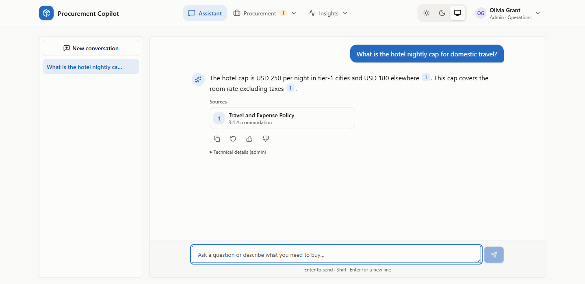
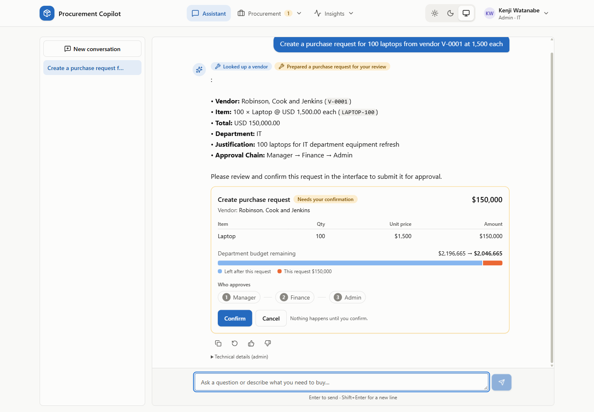
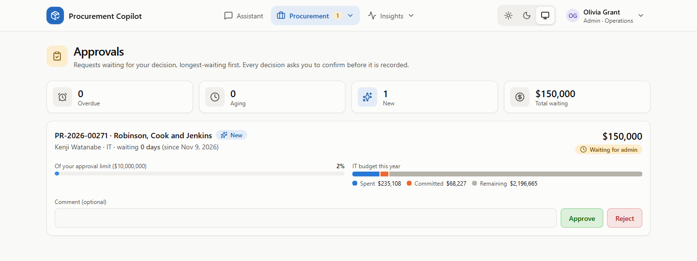
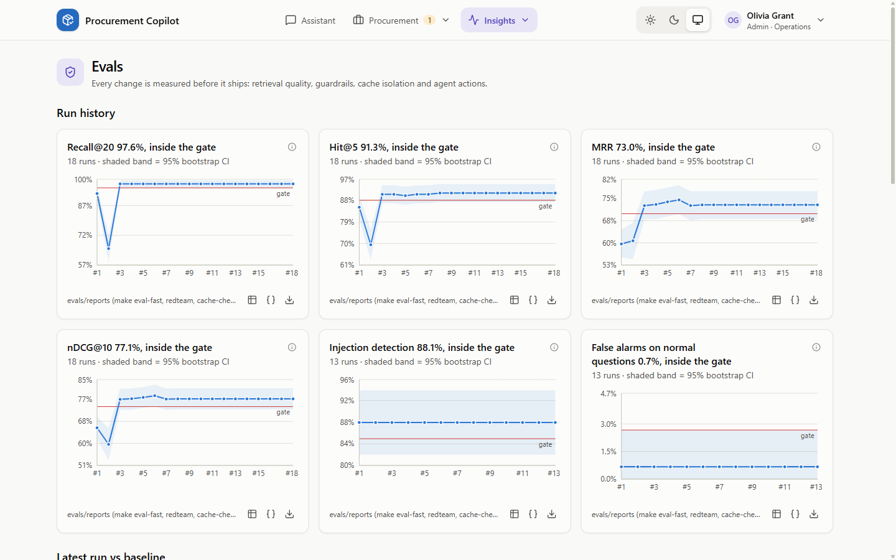
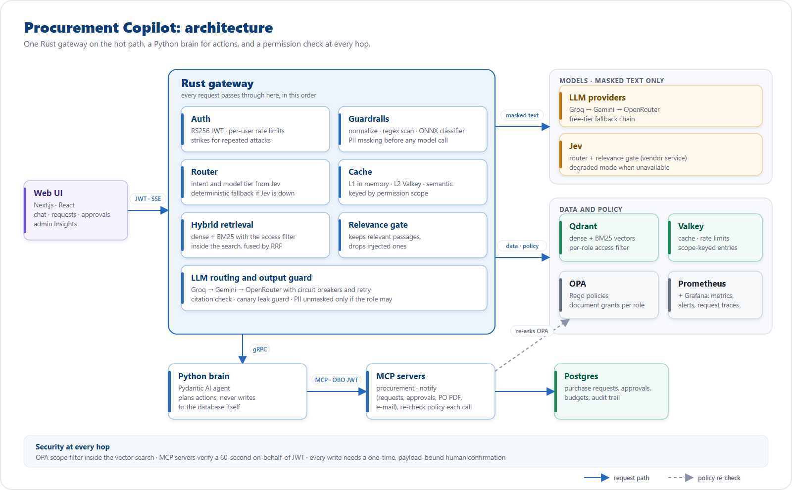
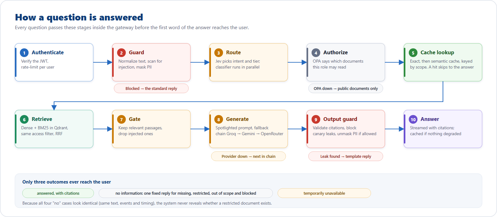

# Procurement Copilot


**Permission-aware RAG and AI agent for enterprise procurement.** Hybrid search with access control inside the vector query, layered prompt-injection defense, and purchase actions that a human must approve. Rust · Python · Next.js · Qdrant · OPA · MCP · Docker.

### What it brings to the table

- **Permission-aware RAG:** the access filter runs inside the vector search, so a user can never retrieve what their role may not read. Missing, restricted and blocked all get the same reply, so nothing leaks.
- **A safe AI agent:** every purchase action is a proposal until a human confirms it with a one-time token. Approvals follow the amount (manager, Finance, admin), then a PO PDF and e-mails go out through MCP tools.
- **Prompt-injection defense in layers:** regex, a router, a local ONNX classifier, PII masking and a canary leak guard. Offline red team: 144 attacks, every hard gate at 0.
- **A fast Rust hot path:** auth, guardrails, routing, three cache layers keyed by permission scope, and streaming. 4,679 RPS on cache hits at p95 26 ms (offline load test).
- **Built to fail safely:** provider fallback with circuit breakers, a deterministic degraded mode, and 8 of 8 failure drills passing.
- **Measured, not assumed:** an eval harness with confidence intervals and regression gates. Recall@20 is 0.976 (offline, mock LLMs).
- **Production habits:** OpenTelemetry, Prometheus and Grafana, 16 decision records, CI, 170+ automated tests, Docker Compose, MIT license.
- **Runs without paid keys:** free-tier LLMs, local models and synthetic data, so no real personal data is involved.

**Skills shown:** system design · security engineering · RAG and evals · caching · full-stack (Rust, Python, TypeScript) · observability · testing and CI.

Acme Corp is fictional. Employees ask questions and raise purchase requests in plain language, limited to what their role may see. A Rust gateway owns the hot path, a Python brain runs the agent, the MCP servers and ingestion, and a Next.js UI sits on top.

> **Documentation:** [User manual (PDF)](user_manual.pdf) · [Architecture handbook](docs/handbook/01-architecture.md) ·
> [Decision records](docs/adr) · [API](docs/api.md) · [Runbook](docs/handbook/04-runbook.md) ·
> [Limitations](Limitation.md)

## Screenshots

Taken from the local demo (live free-tier LLM, synthetic Acme data).

| | |
|---|---|
|  |  |
| **Cited answers.** A question about the hotel cap gets the figure, with a citation chip that opens the exact policy section. | **Human in the loop.** A purchase request is only a proposal until the user presses Confirm. The card shows the budget impact and the approval chain (Manager, Finance, Admin). |
|  |  |
| **Approvals.** After the manager and Finance steps, the $150,000 request waits for an admin, shown with the approver's limit and the department budget. | **Evals in the product.** Admin Insights charts every eval run against its gate: recall, hit rate, injection detection and false alarms. |

## Contents

| | | |
|---|---|---|
| [Screenshots](#screenshots) | [Architecture](#architecture) | [Features](#features) |
| [Results](#results) | [Real, mocked, built](#what-is-real-what-is-mocked-and-what-i-built) | [Quickstart](#quickstart) |
| [Configuration](#configuration) | [Models and data](#models-and-data) | [Demo personas](#demo-personas) |
| [Project layout](#project-layout) | [Testing and CI](#testing-and-ci) | [Security model](#security-model) |
| [Cost model](#cost-model) | [Limitations](#limitations) | [Roadmap](#roadmap) |
| [License and data](#license-and-data) |  |  |

## Architecture



*Vector source: [architecture.svg](docs/images/architecture.svg).*

| Layer | Technology |
|---|---|
| Gateway | Rust, ONNX Runtime (embeddings, injection classifier), moka + Valkey caches |
| Agent / ingestion / MCP | Python 3.14, Pydantic AI, MCP (Streamable HTTP), uv |
| Retrieval | Qdrant (HNSW dense + BM25), nomic-embed-text-v1.5, deterministic RRF fusion |
| Authorization | RS256 JWT, Open Policy Agent (Rego) |
| Data | Postgres, Valkey |
| UI | Next.js (App Router), React, Tailwind, Recharts |
| Observability | OpenTelemetry, Prometheus, Grafana |
| Packaging | Docker Compose, Makefile |

### How a question is answered



Design rationale is recorded in 16 [ADRs](docs/adr) and the [handbook](docs/handbook/01-architecture.md).

## Features

| # | Capability | Implementation |
|---|---|---|
| 1 | Hybrid retrieval | nomic-embed-text-v1.5 + BM25 in Qdrant, the same ACL filter on both branches, deterministic RRF in the gateway |
| 2 | LLM routing + fallback | Jev router picks the intent and a cheap or expensive tier; fallback chain with circuit breakers and retry |
| 3 | Relevance / injection gate | one batched Jev call over the 20 candidates; degraded mode keeps the RRF top-6 |
| 4 | Authorization | JWT RS256 + OPA (Rego, 52 tests); per-classification retrieval grants; MCP servers re-check every call |
| 5 | Guardrails | normalize → regex → Jev → local ONNX classifier (ensemble), PII masking, output guard + canary, silent failure, strikes |
| 6 | Caching | moka L1 → Valkey L2 → semantic (Qdrant), scope-keyed; embedding, retrieval and Jev-decision caches |
| 7 | Agent + actions | Pydantic AI + MCP, propose → confirm with one-time HMAC tokens, PR state machine, PO PDF |
| 8 | Observability | OpenTelemetry traces, Prometheus metrics, 5 Grafana dashboards, 6 alerts, in-app trace waterfall |
| 9 | Evals | eval-fast (bootstrap CIs, hard gates, regression gate), red team, agent tasks, cache isolation, chaos, load tests |
| 10 | UI | chat with citations and action cards, requests, approvals, budgets; admin Insights (overview, evals, experiments, traces) |

## Results

Offline run: mock LLMs and mock Jev, everything else real.

| Area | Result | Reproduce |
|---|---|---|
| Retrieval (263 cases) | recall@20 **0.976**, hit@5 0.913, MRR 0.730, nDCG@10 0.771; 0 forbidden-document retrievals | `make eval-fast` |
| Red team (144 attacks + 150 benign) | **all hard gates 0**; benign FPR 0.7%; 96.6% of blocked responses inside the normal timing band | `make redteam` |
| Agent tasks | **37/37**, 0 unauthorized actions | `make agent-tasks` |
| Cache isolation | **0 cross-scope serves**; exact hit 23 ms vs 902 ms computed | `make cache-check` |
| Resilience | **8/8** failure drills pass (recovery 0.7 to 17 s) | `make chaos` |
| Load | cache hit **4,679 RPS** (p95 26 ms); retrieval 53 RPS at 100 VUs (CPU-bound, see [limitations](#limitations)) | `make loadtest` |
| Experiments | nomic beats bge; RRF k=2 is the best fusion; int8 = fp32; semantic threshold 0.90 | `make experiments` |

Details: [results](docs/handbook/05-results.md), [load tests](docs/loadtest.md), [chaos drills](docs/chaos-drills.md).

## What is real, what is mocked, and what I built

**Real**
- The whole request path runs for real: JWT auth, OPA authorization, hybrid retrieval in Qdrant with the access filter inside the search, guardrails including a local ONNX injection classifier, caching, streaming, the agent with MCP tools, the approval state machine, purchase-order PDFs and e-mail.
- The Docker images build and the stack runs on a laptop. I tested the UI by hand against it with live free-tier LLMs; the screenshots above come from that run.
- Tests: 66 Rust unit tests across the gateway crates, 52 OPA policy tests, Python unit tests, and the eval harness described below.

**Mocked or not verified yet**
- The numbers in the results table were measured offline with mock LLMs and a mock router and gate service. They show the pipeline works and regressions get caught; they do not measure answer quality.
- The router and relevance gate (Jev) have never run against the real service because I have no API key. Without a key the gateway uses its deterministic degraded mode, which is what the screenshots show. Natural-language purchase requests work, but the intent routing is simpler than it would be with Jev.
- There is no answer-quality eval (faithfulness, correctness) with a real LLM yet. That is the next piece of work.
- The injection classifier is a stand-in model, the corpus is synthetic plus public documents, and the Grafana provisioning inside Docker is untested.

**What I built**
- A Rust gateway workspace of 12 crates: the API server, auth, cache, classifier, guard, Jev client, LLM routing, policy, resilience, retrieval, telemetry and a mock LLM for offline runs.
- A Python brain: Pydantic AI agent, two MCP servers, the purchase-request service, ingestion and the synthetic data generator.
- A Next.js UI with chat, requests, approvals, budgets and an admin Insights area.
- OPA policies, Postgres migrations, Docker Compose, Prometheus alerts, Grafana dashboards, k6 load tests, failure drills and a red-team suite.
- 16 [decision records](docs/adr) that explain why each major choice was made.

## Quickstart

**Prerequisites:** Docker (Compose v2), GNU Make, [uv](https://docs.astral.sh/uv/), Node.js 22+, OpenSSL.
On Windows run the `make` targets from WSL or Git Bash. About 10 GB of free disk for images and models.

```bash
git clone https://github.com/S-Harish-Dev/Procurement_Copilot.git && cd Procurement_Copilot

cp .env.example .env      # or `make env`: also generates every secret; add LLM API keys if you have them
make keys                 # RS256 JWT key pair (infra/keys, gitignored)
make up                   # Postgres, Qdrant, Valkey, OPA, Grafana LGTM, Mailpit, gateway, brain, MCP servers
make seed ingest          # load synthetic Acme data, then the committed index bundle (no re-embedding)
make web-install web-dev  # UI at http://localhost:3001
```

Open <http://localhost:3001/login> and pick a persona. Everything listens on `127.0.0.1` only.
`make help` lists every target.

**Low-disk laptop:** skip Grafana and Prometheus with the lean overlay
`docker compose --env-file .env -f infra/docker-compose.yml -f infra/docker-compose.local.yml up -d <services>`.

**No API keys (fully offline):** set `PROVIDERS_FILE=providers.mock.docker.toml`, `JEV_BASE_URL=http://mock-jev:8090`
and `TYPESAFE_API_KEY=mock`, then start with `docker compose --profile offline`. Answers come from deterministic
mock LLMs; retrieval, authorization, guardrails and caching are real.

An advanced no-Docker mode (`make native-stack`) runs the same services as plain processes. It expects the binaries listed at the top of `scripts/native-stack.sh` and is what the load tests and failure drills use by default.

## Configuration

All settings live in `.env` (template: [.env.example](.env.example)); `.env` is gitignored.

| Variable | Purpose |
|---|---|
| `GROQ_API_KEY`, `GEMINI_API_KEY`, `OPENROUTER_API_KEY` | LLM providers, tried in that order. Each accepts several comma-separated keys, rotated round-robin |
| `PROVIDERS_TOML` | provider and model choices ([gateway/providers.toml](gateway/providers.toml)); edit and recreate the gateway, no rebuild |
| `TYPESAFE_API_KEY`, `JEV_BASE_URL`, `JEV_BUDGET_USD` | router and relevance gate; empty key = deterministic degraded mode. Warns at 80% of budget, degrades at 95% |
| `PII_ENCRYPTION_KEY`, `CONFIRMATION_HMAC_KEY`, `INTERNAL_API_TOKEN` | generated by `make env` |
| `JWT_PRIVATE_KEY`, `JWT_PUBLIC_KEY` | generated by `make keys` |
| `HF_TOKEN` | only needed for the gated Prompt Guard 2 model (optional) |

## Models and data

Models are not stored in git. They are large (the classifier alone is over 700 MB), and each one downloads from a
public source on demand.

| Asset | How to get it |
|---|---|
| Embedding models (nomic-embed-text-v1.5; bge for experiments) | downloaded automatically by fastembed on first use into `models/fastembed/` |
| Injection classifier (ProtectAI DeBERTa-v3 stand-in, plus int8 copy) | `make classifier-model` (writes `models/classifiers/`) |
| Public corpus (FAR, World Bank, UN, CUAD) | `make download`; checksums in [data/manifest.json](data/manifest.json) |
| Synthetic Acme data (personas, vendors, contracts, requests) | committed in [data/synthetic](data/synthetic), regenerated deterministically by `make synth` |
| Index bundle (10,356 chunks of FAR, CUAD and Acme documents with nomic-embed-text-v1.5 vectors, ~94 MB) | committed in [data/index_bundle](data/index_bundle), so a fresh clone only runs `make ingest`. It leaves out the UN and World Bank documents (see below) and the three experiment-only embedders. To rebuild everything: `make download build-index ablation` (heavy; many cores recommended) |

The bundle excludes the UN and World Bank documents because their terms of use do not allow redistributing the text
(`excluded_sources` in its manifest). The results above were measured on the full corpus, including those two
documents. None of the 263 retrieval cases has a UN or World Bank document as its gold answer, but re-running the
evals on the committed bundle may move the numbers slightly. Re-running `make experiments` needs `make ablation` first, because the other embedders are not committed.

`make ingest` only loads the bundle into Postgres and Qdrant; it never re-embeds. The bundle is stored byte-exact
(see [.gitattributes](.gitattributes)); its checksums are verified on load.

## Demo personas

One click on `/login`: Priya Sharma (IT employee), Marcus Lee (Marketing employee), James Chen (IT manager), Elena
Petrova (Finance) or Olivia Grant (admin, sees Insights). Try:

1. As Priya, ask for the hotel cap: a cited answer.
2. As Marcus, ask about an IT contract: the same "no information" message as for a truly absent document.
3. Type a prompt injection: a silent no-answer.
4. Raise a USD 15,000 request: an action card, then James approves, then Elena approves, then a purchase-order PDF
   and e-mails appear in Mailpit at <http://localhost:8025>.

The [user manual](user_manual.pdf) walks through every screen.

## Project layout

```
gateway/    Rust workspace: auth, guard, router, cache, retrieval, API (axum), providers.toml
brain/      Python: Pydantic AI agent, MCP servers, ingestion pipeline, evals, tests
web/        Next.js UI (chat, requests, approvals, budgets, admin Insights)
policies/   OPA Rego policies, data and tests
db/         Postgres migrations and seed
data/       corpus manifest, synthetic Acme data (raw downloads are gitignored)
evals/      datasets, red-team cases, experiments, baselines, load-test results
infra/      Docker Compose, Prometheus, Grafana dashboards, k6, chaos drills
docs/       handbook, ADRs, API contract, load-test and chaos reports
prompts/    versioned system, agent, router and gate prompts
proto/      gRPC contract between gateway and brain
scripts/    stack, env and load-test helpers
```

## Testing and CI

```bash
make test        # OPA, Python and Rust unit tests
make lint        # ruff, mypy, opa fmt
make ci          # everything CI runs, incl. gateway tests and web lint
make eval-fast   # retrieval metrics + security hard gates against the running stack (under 1 minute)
make redteam     # prompt-injection suite
make chaos       # failure drills
```

GitHub Actions ([.github/workflows/ci.yml](.github/workflows/ci.yml)) runs lint and unit tests on every push and pull
request. Retrieval evals need the index bundle and a running stack, so they run manually.

## Security model

- No existence oracle. Restricted, absent, out-of-scope and blocked requests all return the same message, events and
  timing. Reason codes are admin-only.
- Least privilege at every hop. OPA scope filters run inside the vector search, MCP servers verify a 60-second
  on-behalf-of JWT and re-ask OPA, and writes need a one-time, payload-bound confirmation token.
- Data minimization. Only PII-masked text leaves the process, document PII stays masked, and caches are keyed by
  permission scope.
- Fail closed. If OPA is down, only public documents are served and no writes happen. If the classifier is
  unavailable, the system runs degraded, raises an alert and never caches the result.

The repository contains one RSA key, `gateway/crates/auth/testdata/test-private.pem`, a throwaway fixture for unit
tests. Real keys are generated locally by `make keys`.

## Cost model

Actual cost offline is $0 (mock providers). With keys: free LLM tiers ($0) plus Jev at about $0.042 per million
input tokens, metered against a budget. Insights shows actual versus "shadow" cost (every answer at the expensive tier
with no cache and no router). Measured offline, Jev spend exceeds the mock LLM savings, so actual > shadow; the
dashboard says so instead of claiming savings.

## Limitations

Full list in [Limitation.md](Limitation.md). The main ones:

- Free-tier rate limits on Groq, Gemini and OpenRouter cap throughput. Gemini's free tier may use prompts for
  training, so only public or synthetic data is sent.
- Jev is a vendor dependency with vendor-reported benchmarks. A deterministic degraded mode covers its outages.
- Offline numbers measure the pipeline, not the models. Answer quality, router accuracy and judge agreement need
  real keys.
- The injection classifier is a stand-in (ProtectAI DeBERTa-v3) for Prompt Guard 2, which is gated. Swapping it is a
  directory change.
- The target of retrieval p95 under 100 ms at 100 VUs is not met on a shared CPU, because query embedding is the
  bottleneck. A single request takes 82 ms at p95.
- The demo runs locally only. Free hosts cannot run this stack, so there is no public hosting.

## Roadmap

Kubernetes with HPA on gateway CPU and embedder queue depth; public hosting behind SSO; a fine-tuned embedder on real
query logs; Prompt Guard 2 once licensed; a v2 injection-pattern file; semantic-cache tuning on real traffic;
OpenTelemetry metrics push instead of the extra Prometheus.

## License and data

The source code is released under the [MIT License](LICENSE). Third-party data keeps its own terms:

- FAR: public domain. World Bank Procurement Regulations and UN Procurement Manual: the raw files are downloaded at
  build time and not redistributed, and the committed index bundle excludes them.
- CUAD v1 (100-contract subset): The Atticus Project, CC BY 4.0.
- Synthetic Acme data: 15 personas, 200 vendors with fake PII, 30 contracts, 500 historical purchase requests and
  5 planted prompt-injection documents, generated from a fixed seed.
