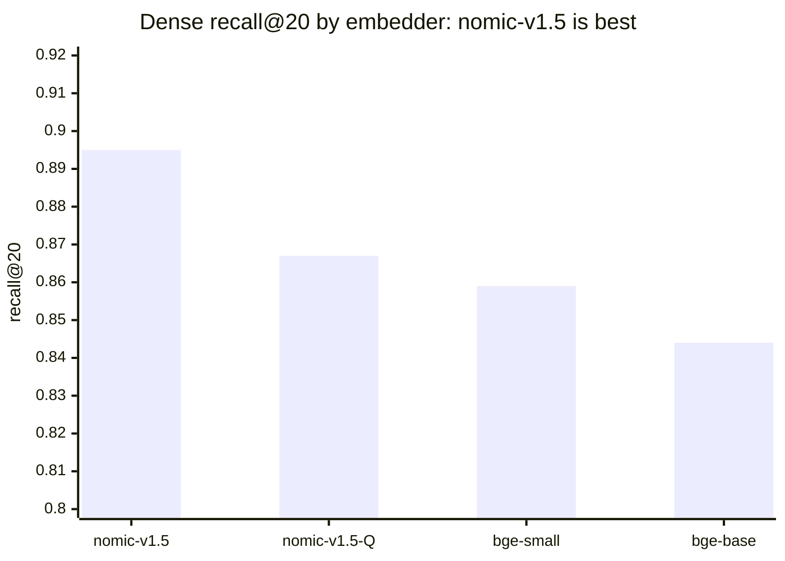
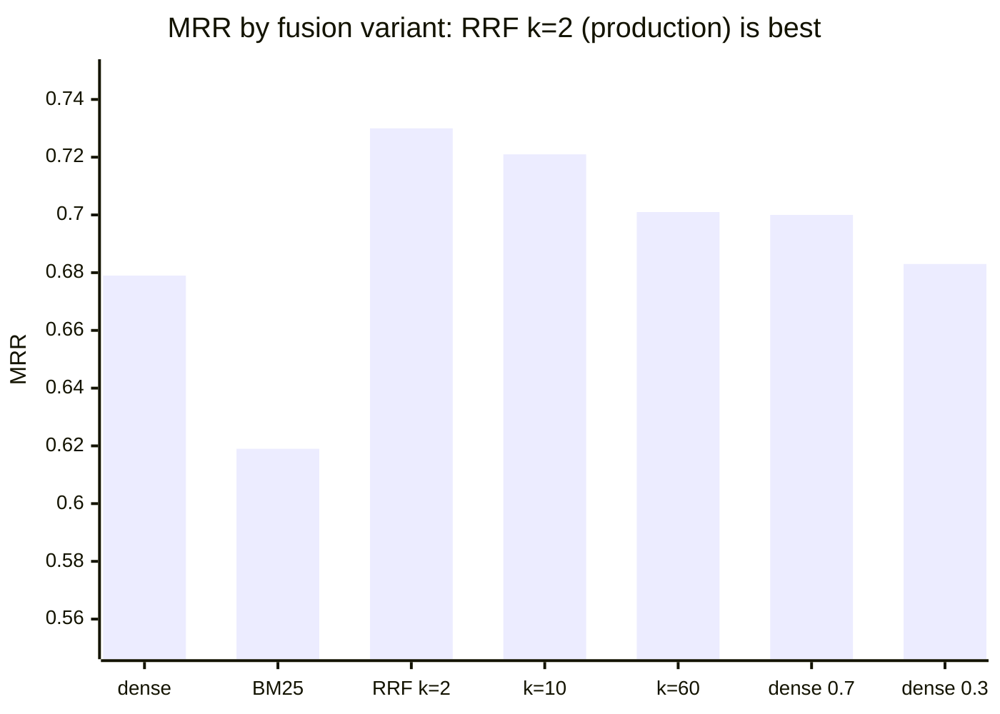
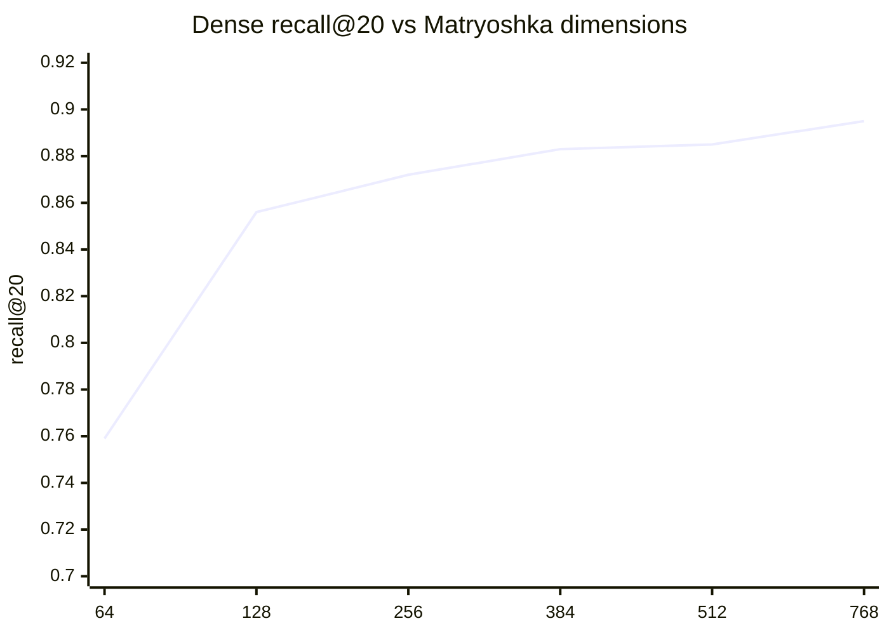
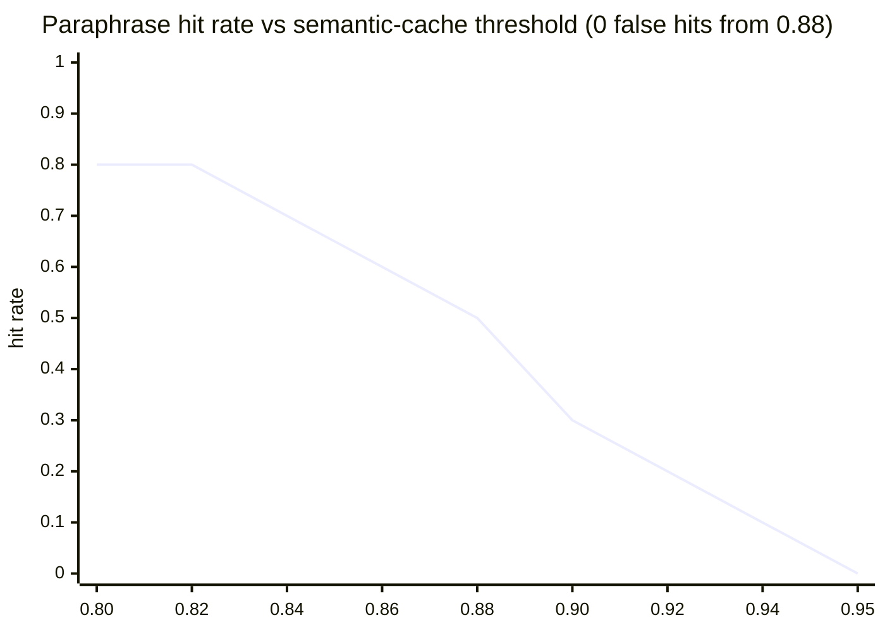

# 5. Evaluation and experiment results

Every number here comes from a committed script and can be regenerated. All runs were offline, with mock LLMs
and a mock Jev and with real everything else, on a 64-core CPU-only machine on 2026-10-30. Model-quality
numbers (faithfulness, answer correctness, judge agreement) need real API keys and are not reported.

## 5.1 Retrieval quality (`make eval-fast`, baseline v3)

263 cases: 185 answerable, 40 unanswerable, 38 role-restricted. Means with seeded bootstrap 95% CIs, production
path through `/admin/eval/retrieve`.

| Metric | Mean | 95% CI | Gate |
|---|---|---|---|
| recall@20 | 0.976 | 0.954-0.994 | −0.02 vs baseline |
| hit@5 | 0.913 | 0.876-0.951 | −0.03 |
| MRR | 0.730 | 0.682-0.776 | −0.03 |
| nDCG@10 | 0.771 | 0.731-0.812 | −0.03 |
| guard detection (regex + classifier) | 0.881 | 0.822-0.941 | −0.03 |
| guard benign FPR | 0.007 | 0.000-0.027 | +0.02 (lower is better) |

Hard gates, all 0: forbidden-document retrievals, ACL leaks, OPA test failures (52 policy tests).

## 5.2 Security (`make redteam`, `make cache-check`, `make agent-tasks`)

| Check | Result |
|---|---|
| Red team: 144 attacks, 8 categories | all hard gates 0 (leaks, PII, prompt leak, unauthorized actions, template mismatch, HTTP abuse 12/12 fail closed) |
| Blocked by the input guard | direct 45/45, canary 3/3, extraction 28/35, role-play 12/18 (the other categories are stopped downstream by ACL, masking and confirmation) |
| Benign false positives | 1/150 (0.7%): "Can I approve my own purchase request?" |
| Silent-failure timing | 96.6% of blocked responses inside the p5 to p95 band of computed answers |
| Lockout | 10 strikes, then even a benign question gets the template |
| Cache scope isolation | 10 probes, 0 cross-scope serves; semantic hits 30% at threshold 0.90 |
| Agent tasks | 37/37, unauthorized actions 0 |

## 5.3 Experiments (`make experiments`)

Dense-only recall@20 by embedder (the production path adds BM25 and reaches 0.976):

Fusion: MRR by variant. Hybrid beats either branch, and the production RRF k=2 is the best variant:

Matryoshka: dense recall@20 versus dimensions. 256 dimensions keep 0.872 for a third of the memory:

Semantic-cache threshold: paraphrase hit rate (10 pairs) as the threshold rises. False hits on 7,284 hard
negative pairs reach zero at 0.88 (hardest 0.874), so production uses 0.90:

| Experiment | Finding | Decision |
|---|---|---|
| HNSW ef | ef=8 already returns 100% of the exact top-20: ACL-filtered sets are small | defaults kept |
| int8 vs fp32 | int8+rescore = int8 = fp32 = exact (recall@20 0.895) | int8 with rescore (¼ RAM) |
| Classifier τ | τ=0.9: recall 83.2%, precision 89.4% (101 attacks vs 172 benign + command messages); bimodal scores: τ=0.5 adds 3 detections at no extra false positives; the 10 false positives all score ≥ 0.95 | τ_cls 0.9 kept; the 6-word rule, not τ, removes the false positives |

The precision-recall table for τ is in `evals/experiments/tau_classifier.json`.

## 5.4 Load and resilience (`make loadtest`, `make chaos`)

| Scenario | RPS | p50 | p95 | Target |
|---|---|---|---|---|
| Exact cache hit, 64 VUs | 4,679 | 12 ms | 26 ms | 1-5k RPS ✓ |
| Retrieval only, 100 VUs | 53 | 1.84 s | 2.02 s | p95 < 100 ms ✗ (CPU embedding; single request p95 82 ms) |
| Full Q&A, caches off, 32 VUs | 24 | 1.46 s | 2.27 s | reported |

Chaos: 8/8 rows of the resilience matrix behave as specified. Recovery takes 0.7-2.2 s, and 17 s for Jev
(the breaker cooldown). See `docs/chaos-drills.md` and the runbook (chapter 4).
